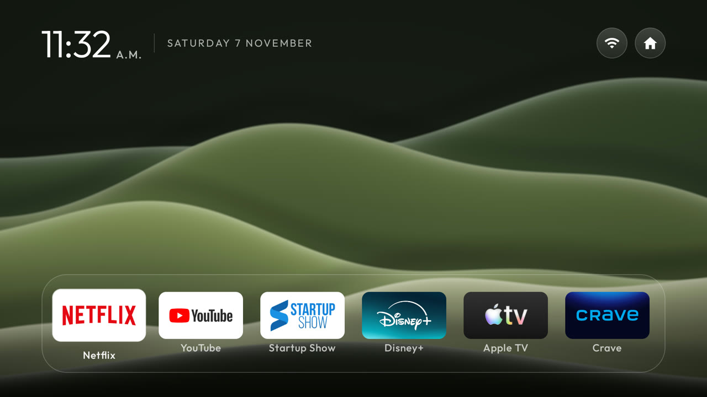
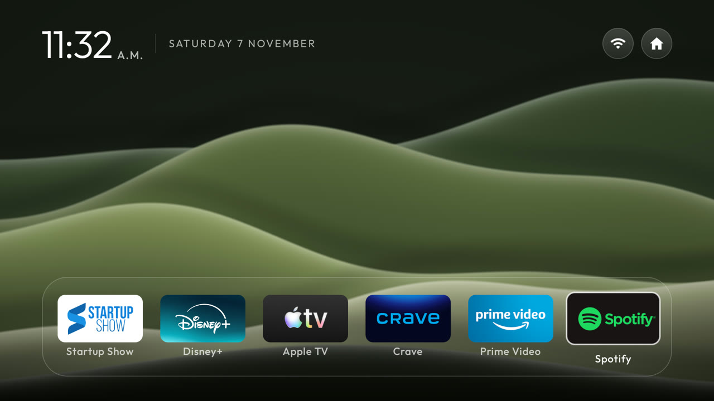
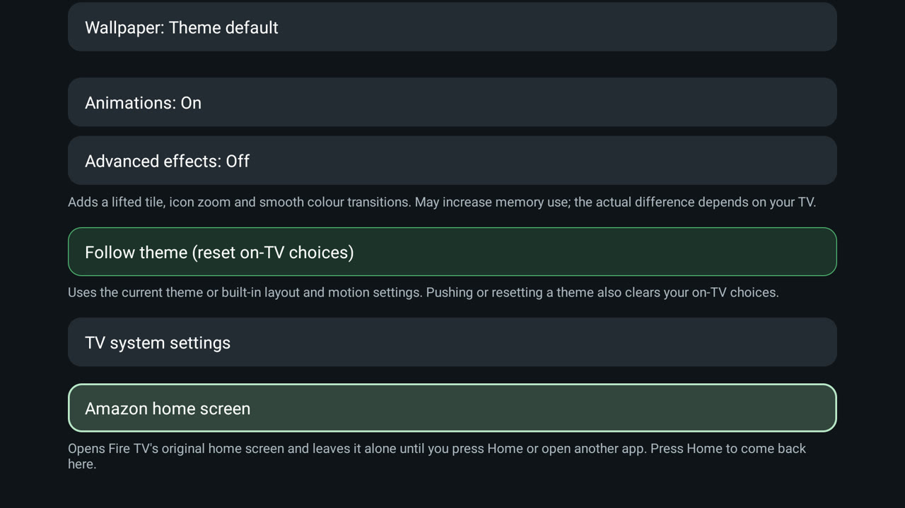
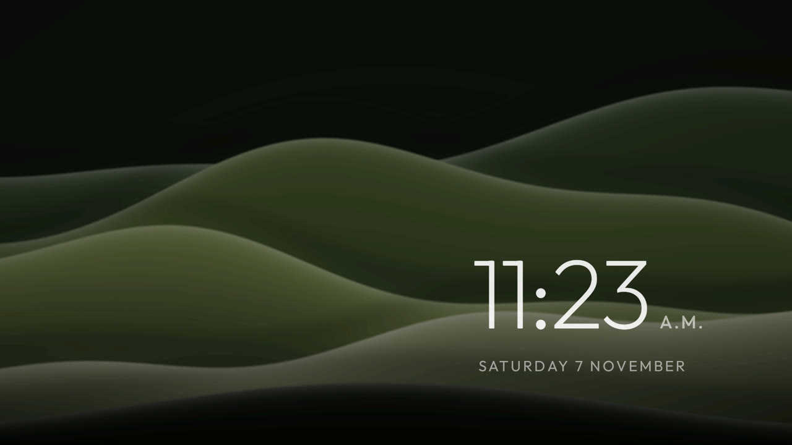

# CleanYourTV for Fire TV Stick

A fork of [Gathin23/cleanyourtv](https://github.com/Gathin23/cleanyourtv) that turns an older, Android-based
**Fire TV Stick** into a quiet, ad-free home screen in the spirit of
[CleanFrame](https://github.com/nthnclrk/CleanFrame), without root. Upstream CleanYourTV supports Fire TV for
debloating only, because Fire OS won't let another app be Home; this fork adds the missing Home takeover.

Tested on a Fire TV Stick 3rd gen (Fire OS 7.7.1.7, Android 9). The original README is in
[README.upstream.md](README.upstream.md).



## What is different from upstream

| | Upstream CleanYourTV | This fork |
|---|---|---|
| Home button on Fire OS | Goes to Amazon's home screen | Comes back to this launcher (see [How Home works](#how-home-works)) |
| Amazon's home screen | n/a | Still installed; one row away in Launcher settings, **Amazon home screen** |
| Single scrolling row | Dock band follows the tiles and slides off screen | Band stays fixed while the apps scroll inside it |
| Theme | Upstream themes | [`themes/cleanframe-look`](themes/cleanframe-look): CleanFrame-style row on a glass dock, seven original wallpapers |
| Screensaver | Amazon's, with sponsored content | The launcher's clock drifting over the wallpaper, no ads |
| Tools | `build-and-install.sh` (refuses on Fire OS) | [`tools/firestick.sh`](tools/firestick.sh) install/theme/undo, [`tools/firestick-bench.sh`](tools/firestick-bench.sh) |

New code: [`FireHome.java`](launcher/app/src/main/java/com/gathin/tvhome/FireHome.java),
[`FireHomePolicy.java`](launcher/app/src/main/java/com/gathin/tvhome/FireHomePolicy.java) (with
[unit tests](launcher/app/src/test/java/com/gathin/tvhome/FireHomePolicyTest.java)), and small hooks in
`HomeKeyService`, `MainActivity`, `LauncherSettingsActivity` and `DockDecoration`. The APK is about 1.4 KB over
upstream's 576 KB size gate, which only matters for a pull request upstream.

## Screenshots

All from the stick itself.

| The row scrolls under a fixed glass band | Launcher settings, with Amazon's home one row away |
|---|---|
|  |  |

| Ad-free screensaver | The seven wallpapers (moss is the default) |
|---|---|
|  |  |

The wallpapers are original abstract waves drawn by
[`make_wallpapers.py`](themes/cleanframe-look/make_wallpapers.py) (CC0). Edit a palette and rerun it to make your own.

## How Home works

Fire OS ignores the default-home setting, can't disable Amazon's launcher without root, never passes the Home key to
accessibility services, and holds back activity starts from background apps for 5 s after Home. `FireHome` (inside
`HomeKeyService`, on when `stock_home_redirect` is `com.amazon.tv.launcher`) works around that:

1. Amazon's `HOME_PRESSED` broadcast, or the window event for Amazon's `HomeActivity`, shows a cover: a full-resolution
   snapshot of this launcher's last frame in an accessibility overlay, about 0.2 s after Home.
2. Behind it, the launcher's own task is moved to the front. The move runs off the main thread (it can block for
   seconds) and is retried every 300 ms until it sticks; with no live task, an exact alarm plus a direct start.
3. D-pad and OK pressed under the cover are queued and replayed into the launcher when it takes over. Home keeps the
   launcher's place, so the real screen is the same frame as the snapshot. The cover fails open after 6 s.

`FireHomePolicy` leaves Amazon's settings screens alone, ignores Amazon's home flashing on the way into Settings, stops
after a burst of redirects (loop guard), and pauses while you use **Amazon home screen** until Home or another app.

Ideas from [FireFrame](https://github.com/dyascj/FireFrame), the
[bearylabs/hrudek `firetv` fork](https://github.com/bearylabs/cleanyourtv/tree/firetv) and
[andrewsaad/fire-tv-cleanup](https://github.com/andrewsaad/fire-tv-cleanup), all MIT.

## Install

On the stick: Settings > My Fire TV > About, press OK seven times on the device name, then Developer options >
ADB debugging on. You need JDK 17, the Android SDK (platform 34, build-tools 34.0.0) and `adb`.

```sh
tools/firestick.sh install <stick ip>                        # build, install, turn on the Home service
tools/firestick.sh theme <stick ip> themes/cleanframe-look    # push the theme and wallpapers
adb shell settings put secure screensaver_components com.gathin.tvhome/.ClockDream   # ad-free screensaver
```

Undo: `tools/firestick.sh undo <stick ip> [--uninstall]` sends Home back to Amazon, and
`adb shell settings put secure screensaver_components com.amazon.ftv.screensaver/.app.services.ScreensaverService`
restores Amazon's screensaver. Switch ADB debugging off when you're done; port 5555 is unencrypted.

- Reinstall through `firestick.sh install`: a plain `adb install -r` can leave the Home service off.
- On macOS, if `adb connect` says "No route to host" while the port is open, run `python3 tools/relay.py <stick ip>`
  and use `127.0.0.1:15555` ([tools/native-adb.md](tools/native-adb.md)).
- In the theme, the top-right house button opens Launcher settings (`launcher_settings_button`); Fire TV's own
  settings are a row inside it.

## Speed

Home from an app back to the launcher on a Fire TV Stick 3rd gen, median of `tools/firestick-bench.sh`:

| Setup | Median |
|---|---|
| Stock Fire OS | 2.46 s |
| After the upstream [`amazon-fire-tv-stick-2020`](examples/amazon-fire-tv-stick-2020/debloat.txt) debloat | 2.34 s |
| Plus Featured Content video and audio autoplay off | **1.76 s** |

Autoplay off: `adb shell settings put global com.amazon.tv.settings.featured_item_video_enabled 0` (or Settings >
Preferences > Featured Content). Animation scales at 0.5x help too. What's left is Amazon's own home screen
resuming, which Fire OS requires before any other task can come to the front.

## Licence

MIT, as upstream ([LICENSE](LICENSE)). The Outfit font is under the SIL Open Font License; app names and logos on the
screenshots belong to their owners.
